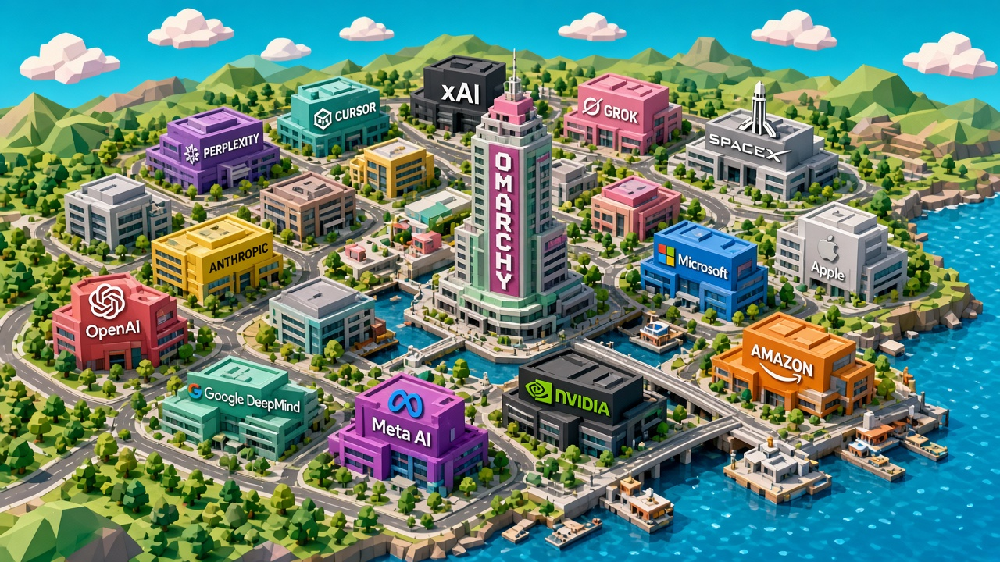

# AI Valley

An Omarchy theme inspired by the *Silicon Valley* intro — colorful isometric 3D tech campus energy, updated for the AI era.



## Installation

```bash
omarchy theme install https://github.com/nickpstone/omarchy-ai-valley-theme
```

## Palette

Dark bay-night UI with a bright California-campus wallpaper set.

| Role | Color | Feel |
|------|-------|------|
| Background | `#0b1a24` | Deep bay night |
| Accent / Cyan | `#00c2d7` | Turquoise sky & water |
| Orange | `#ff7a45` | Campus coral |
| Yellow | `#ffd166` | Sunny California |
| Green | `#3ddc97` | Hills & mint glass |
| Magenta | `#ff6b9d` | Neon dusk signs |

## Wallpapers

Cycle with `omarchy theme bg next`:

1. `1-ai-valley-skyline` — Full AI Valley overview with the Omarchy wordmark tower
2. `2-omarchy-hq` — Omarchy HQ hero with official wordmark
3. `3-ai-campus-row` — Boulevard of AI company HQs
4. `4-spacex-xai` — SpaceX, xAI, and Grok district
5. `5-openai-anthropic` — Twin OpenAI / Anthropic towers
6. `6-dusk-neon-valley` — Sunset neon campus
7. `7-cursor-plaza` — Cursor plaza with Omarchy landmark
8. `8-freeway-approach` — Freeway approach into the valley
9. `9-bay-aerial` — Aerial bayfront campus

Companies featured: OpenAI, Anthropic, Google DeepMind, Meta AI, Nvidia, Microsoft, Apple, Amazon, Perplexity, Cursor, xAI, Grok, SpaceX, and **Omarchy**.

## Usage

```bash
omarchy theme set "AI Valley"
omarchy theme bg next
```

---

Fan-made theme. Visual style homage to HBO's *Silicon Valley* intro; not affiliated with HBO or the companies depicted.
